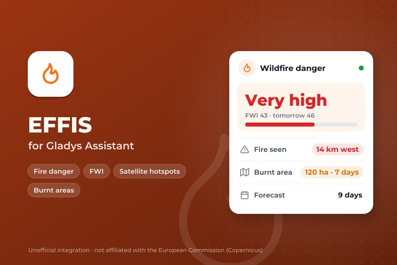
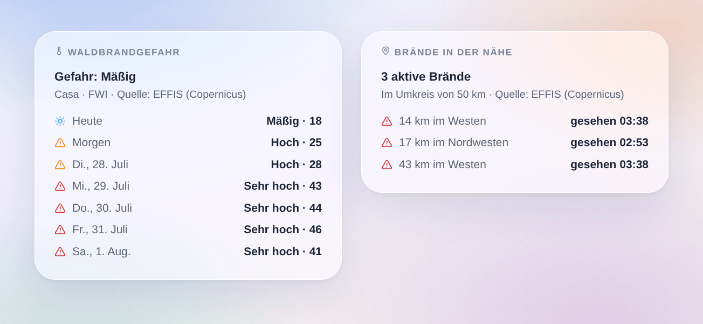
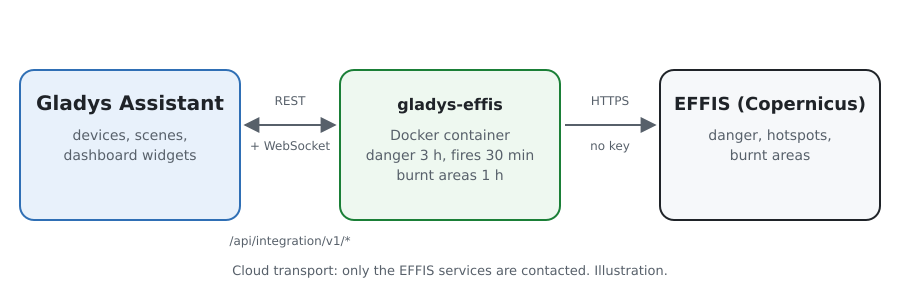
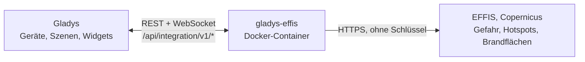
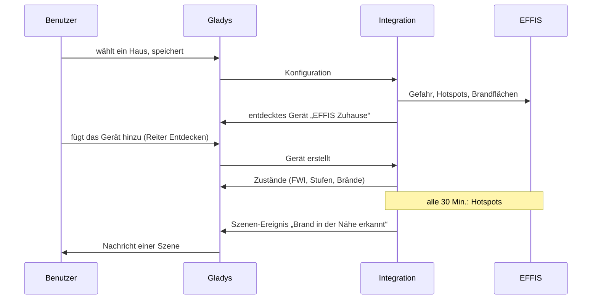

# Gladys EFFIS

[English](README.md) · [Français](README.fr.md) · **Deutsch** · [Español](README.es.md)

[](LICENSE)
[](https://github.com/William-De71/gladys-effis/releases)
[](https://github.com/William-De71/gladys-effis/actions/workflows/release.yml)
[](https://gladysassistant.com)



Eine externe Integration für [Gladys Assistant](https://gladysassistant.com), die EFFIS, das Europäische Waldbrandinformationssystem von Copernicus (Europäische Kommission), in Gladys bringt: die Vorhersage der Waldbrandgefahr Ihrer Orte, die per Satellit erkannten Brände in ihrer Umgebung und die von EFFIS kartierten Brandflächen. Offene Daten unter CC BY 4.0: kein Konto, kein Schlüssel.

Benutzerdokumentation: [English](docs/en.md) · [Français](docs/fr.md) · [Deutsch](docs/de.md) · [Español](docs/es.md).

## Funktionen

- Ein **Gerät pro Ort** (ein Gladys-Haus oder Koordinaten, bis zu drei): Feuerwetterindex und heutige Gefahrenstufe, Gefahr von morgen, per Satellit erkannte Brände in der Nähe, die Lage als Satz.
- **3 Szenen-Auslöser**: Gefahrenstufe geändert (Filter: Stufe, steigt oder sinkt), Brand in der Nähe erkannt, Brandfläche in der Nähe.
- **1 Szenen-Aktion**: die Waldbrandgefahr heute, morgen oder übermorgen, mit den Bränden in der Nähe.
- **2 Dashboard-Widgets**: die Gefahr der nächsten Tage, die Brände in der Nähe.
- Ein Umkreis von 10 bis 100 km; Englisch, Französisch, Deutsch und Spanisch überall.

Kein offizieller Warndienst: Ein per Satellit erkannter Brand kann ein Agrarfeuer oder eine industrielle Wärmequelle sein, und keine Erkennung heißt nicht, dass es nicht brennt.



## Funktionsweise







Die Waldbrandgefahr ist der kanadische Feuerwetterindex (FWI) der EFFIS-Vorhersage (ECMWF-Modell, 8 km), für den Ort gelesen, ein Wert pro Tag von gestern bis 9 Tage voraus; seine Stufe folgt den Klassen der EFFIS-Karten. Hotspots sind die thermischen Anomalien der letzten 24 Stunden (MODIS, VIIRS, Sentinel-3) in einem Gebiet um den Ort; Hotspots, die weniger als 2 km auseinanderliegen, sind ein Brand. Brandflächen sind die von EFFIS kartierten Brände (Europa, Naher Osten, Nordafrika).

### Transport

Nur Cloud: Die Integration kontaktiert die EFFIS-Server der Europäischen Kommission (`api.effis.emergency.copernicus.eu`, `maps.effis.emergency.copernicus.eu`) und sonst nichts. Die Koordinaten Ihrer Orte werden dorthin gesendet. Der Katalog zeigt das Abzeichen „Cloud“.

## Geräte und Funktionen

| Funktion                  | Kategorie / Typ              | Werte                                                           |
| ------------------------- | ---------------------------- | --------------------------------------------------------------- |
| Feuerwetterindex (FWI)    | `risk` / `integer`           | 0 bis 200, heutiger FWI gerundet                                |
| Waldbrandgefahr heute     | `risk` / `integer`           | 0 gering, 1 mäßig, 2 hoch, 3 sehr hoch, 4 extrem, 5 sehr extrem |
| Waldbrandgefahr morgen    | `risk` / `integer`           | dasselbe, morgen                                                |
| Brände in der Nähe (24 h) | `counter-sensor` / `integer` | per Satellit erkannte Brände im Umkreis                         |
| Lage                      | `text` / `text`              | die Gefahr und der nächste Brand, als Satz                      |

## Szenen-Auslöser, Aktionen und Widgets

| Art      | Schlüssel              | Verwendung                                                           |
| -------- | ---------------------- | -------------------------------------------------------------------- |
| Auslöser | `danger_level_changed` | Die heutige Stufe hat sich geändert (Filter: Gerät, Stufe, Richtung) |
| Auslöser | `fire_detected`        | Ein neuer, per Satellit erkannter Brand im Umkreis                   |
| Auslöser | `burnt_area_mapped`    | Eine neue, von EFFIS kartierte Brandfläche im Umkreis                |
| Aktion   | `get_fire_danger`      | Heute, morgen oder übermorgen: FWI, Stufe, Brände, Zusammenfassung   |
| Widget   | `danger`               | Die Stufe heute und an den nächsten Tagen (3 bis 9)                  |
| Widget   | `fires`                | Brände der letzten 24 h, in 7 Tagen kartierte Brandflächen           |

Beispiele:

- Wenn die Stufe sehr hoch oder höher wird → `{{triggerEvent.data.summary}}` senden und abends den Garten bewässern.
- Wenn ein Brand in der Nähe erkannt wird → `{{triggerEvent.data.summary}}` an die Familie senden.
- Jeden Morgen (geplante Szene) → „Waldbrandgefahr abrufen“ → eine Nachricht, wenn die Stufe hoch oder höher ist.

## Voraussetzungen

- Gladys Assistant **5.3.0** oder neuer (Haus-Auswahl, Katalog-Schlüsselwörter, Widgets und Szenen externer Integrationen). Ältere Instanzen können sie nicht installieren.
- Ein in Gladys verortetes Haus oder Koordinaten; Internetzugang von Gladys aus.

## Installation

- **Aus dem Store**: Integrationen → „EFFIS“ suchen → Installieren.
- **Über die URL des Repositorys**: Integrationen → Integration installieren → `https://github.com/William-De71/gladys-effis`.
- **Entwicklermodus**: siehe die Gladys-Dokumentation zu externen Integrationen und [Entwicklung](#entwicklung).

## Konfiguration

| Feld                  | Beschreibung                                                            |
| --------------------- | ----------------------------------------------------------------------- |
| Haus (×3)             | Ein Gladys-Haus: seine Position wird verwendet                          |
| Oder Koordinaten (×3) | „Breite, Länge“, haben Vorrang vor dem Haus                             |
| Umkreis               | 10, 25 (Standard), 50 oder 100 km                                       |
| Sprache               | Namen der Funktionen, Szenentexte und Status; standardmäßig automatisch |

Die Aktion **Orte prüfen** zeigt die verwendeten Koordinaten und was EFFIS dort gerade meldet.

## Verwendung

1. Konfigurieren Sie die Orte und speichern Sie.
2. Fügen Sie im Reiter **Entdecken** die Geräte „EFFIS …“ hinzu.
3. Fügen Sie die Widgets einem Dashboard hinzu und erstellen Sie Szenen mit den Auslösern und der Aktion. Die Details stehen in der [Dokumentation](docs/de.md).

## Entwicklung

```bash
npm install
npm test                       # node --test, nie mit Netzwerkzugriff (aufgezeichnete EFFIS-Antworten)
npm run lint && npm run format:check
npx github:GladysAssistant/integration-store . --skip-image-check
scripts/build-cover.sh         # cover.jpg aus docs/assets/cover.svg
docs/illustrations/render.sh   # docs/assets/widgets.<Sprache>.png
node .github/scripts/release.mjs next
```

Lokal liest das SDK `GLADYS_HOST_API_URL`, `GLADYS_INTEGRATION_TOKEN` und `GLADYS_INTEGRATION_SELECTOR`, und `TZ` legt die Zeitzone der Tage fest; `DEBUG=gladys-integration-sdk` gibt die SDK-Protokolle aus. Die Regeln des Projekts stehen in [CLAUDE.md](CLAUDE.md).

## Release-Prozess


Jeder Merge auf `main` startet die CI und berechnet dann die Version aus den [Conventional Commits](https://www.conventionalcommits.org/de/) seit dem letzten Tag: `feat` → Minor, `fix` / `perf` → Patch, `!` oder `BREAKING CHANGE` → Major (vor 1.0.0 ein Minor); `docs`, `chore`, `ci`, `test`, `style`, `refactor`, `build` allein veröffentlichen nichts. Der Changelog-Abschnitt wird erzeugt, das Tag gepusht, das Multi-Arch-Image gebaut, dann erhält `main` den Release-Commit, das GitHub-Release wird erstellt und ein letzter Job prüft das öffentliche Image, den Store-Validator und das Topic.

- Der Titel des Pull Requests wird zum Squash-Commit und dann zur Changelog-Zeile: Schreiben Sie ihn auf Englisch, für den Benutzer. Bearbeiten Sie `CHANGELOG.md` nie von Hand.
- 1.0.0 ist eine Entscheidung: Actions → Release → Run workflow mit `release-as: 1.0.0`. `dry-run` zeigt Version und Notizen, ohne etwas zu veröffentlichen.
- Das Ruleset des Branches verbietet nur Löschen und Force-Push: Eine Regel, die Pull Requests oder Status-Checks verlangt, würde den Release-Commit blockieren (GitHub Actions die Umgehung erlauben oder eine GitHub App nutzen).

## Fehlerbehebung

Siehe die [Dokumentation](docs/de.md#fehlerbehebung): Haus ohne Position, Koordinaten nicht verstanden, EFFIS ausgelastet, ein Brand auf der EFFIS-Karte, aber nicht in Gladys.

## Mitwirken

Issues und Pull Requests sind willkommen. Führen Sie vor einem Pull Request `npm run format:check && npm run lint && npm test` aus und ändern Sie nie einen gespeicherten Schlüssel (externe IDs, Schlüssel der Auslöser und der Aktion: siehe [CLAUDE.md](CLAUDE.md)).

## Sicherheit

Siehe [SECURITY.md](SECURITY.md): Melden Sie Schwachstellen vertraulich. Die Integration hat kein Geheimnis, sendet nur Koordinaten an EFFIS und läuft schreibgeschützt, ohne Root-Rechte, in ihrem Container.

## Bildschirmfotos folgen

Echte Bildschirmfotos des Geräts in Gladys (Reiter Entdecken, Geräteseite) ersetzen die generierten Illustrationen, sobald die Integration auf einer echten Instanz läuft.

## Lizenz

[Apache-2.0](LICENSE). Daten: EFFIS, Copernicus-Katastrophen- und Krisenmanagementdienst, Europäische Kommission, unter CC BY 4.0: siehe [NOTICE](NOTICE). Keine Verbindung zur Europäischen Kommission; kein offizieller Warndienst.
