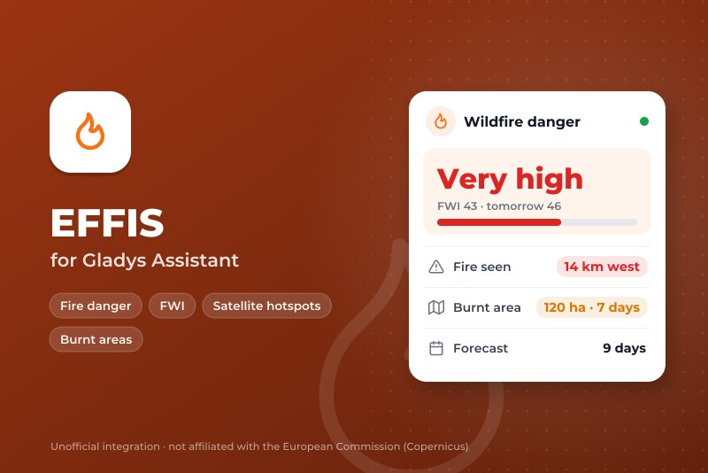
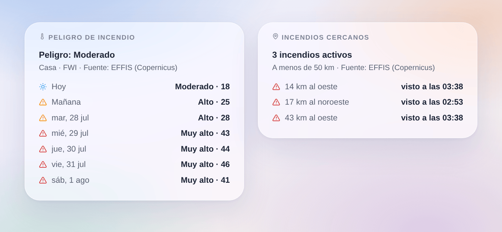
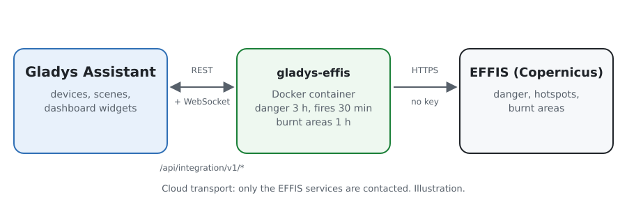
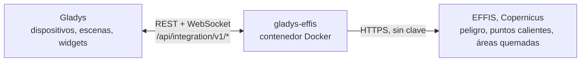
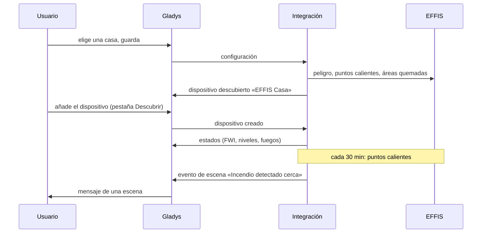

# Gladys EFFIS

[English](README.md) · [Français](README.fr.md) · [Deutsch](README.de.md) · **Español**

[](LICENSE)
[](https://github.com/William-De71/gladys-effis/releases)
[](https://github.com/William-De71/gladys-effis/actions/workflows/release.yml)
[](https://gladysassistant.com)



Una integración externa para [Gladys Assistant](https://gladysassistant.com) que trae EFFIS, el Sistema Europeo de Información sobre Incendios Forestales de Copernicus (Comisión Europea), a Gladys: la previsión del peligro de incendio forestal de sus lugares, los fuegos vistos por satélite a su alrededor y las áreas quemadas que EFFIS cartografía. Datos abiertos con licencia CC BY 4.0: sin cuenta, sin clave.

Documentación de usuario: [English](docs/en.md) · [Français](docs/fr.md) · [Deutsch](docs/de.md) · [Español](docs/es.md).

## Funciones

- Un **dispositivo por lugar** (una casa de Gladys o coordenadas, hasta tres): índice meteorológico de incendios y nivel de peligro de hoy, peligro de mañana, fuegos vistos por satélite cerca, la situación en una frase.
- **3 disparadores de escena**: nivel de peligro cambiado (filtros: nivel, sube o baja), incendio detectado cerca, área quemada cercana.
- **1 acción de escena**: el peligro de incendio de hoy, mañana o pasado mañana, con los fuegos cercanos.
- **2 widgets de panel**: el peligro de los próximos días, los fuegos cercanos.
- Un radio de 10 a 100 km; inglés, francés, alemán y español en todas partes.

No es un servicio oficial de alertas: un fuego visto por satélite puede ser una quema agrícola o una fuente de calor industrial, y que no haya detección no significa que no haya fuego.



## Funcionamiento







El peligro de incendio es el índice meteorológico de incendios canadiense (FWI) de la previsión de EFFIS (modelo ECMWF, 8 km), leído para el lugar, un valor por día desde ayer hasta 9 días adelante; su nivel sigue las clases de los mapas de EFFIS. Los puntos calientes son las anomalías térmicas de las últimas 24 horas (MODIS, VIIRS, Sentinel-3) en una zona alrededor del lugar; los puntos calientes a menos de 2 km entre sí forman un solo fuego. Las áreas quemadas son los incendios cartografiados por EFFIS (Europa, Oriente Medio, Norte de África).

### Transporte

Solo nube: la integración contacta con los servidores de EFFIS de la Comisión Europea (`api.effis.emergency.copernicus.eu`, `maps.effis.emergency.copernicus.eu`) y nada más. Las coordenadas de sus lugares se les envían. El catálogo muestra la insignia «nube».

## Dispositivos y funciones

| Función                           | Categoría / tipo             | Valores                                                          |
| --------------------------------- | ---------------------------- | ---------------------------------------------------------------- |
| Índice meteorológico de incendios | `risk` / `integer`           | 0 a 200, FWI de hoy redondeado                                   |
| Peligro de incendio hoy           | `risk` / `integer`           | 0 bajo, 1 moderado, 2 alto, 3 muy alto, 4 extremo, 5 muy extremo |
| Peligro de incendio mañana        | `risk` / `integer`           | lo mismo, mañana                                                 |
| Incendios cercanos (24 h)         | `counter-sensor` / `integer` | fuegos vistos por satélite dentro del radio                      |
| Situación                         | `text` / `text`              | el peligro y el fuego más cercano, en una frase                  |

## Disparadores, acciones de escena y widgets

| Tipo       | Clave                  | Uso                                                                 |
| ---------- | ---------------------- | ------------------------------------------------------------------- |
| Disparador | `danger_level_changed` | El nivel de hoy cambió (filtros: dispositivo, nuevo nivel, sentido) |
| Disparador | `fire_detected`        | Un nuevo fuego visto por satélite dentro del radio                  |
| Disparador | `burnt_area_mapped`    | Una nueva área quemada cartografiada por EFFIS dentro del radio     |
| Acción     | `get_fire_danger`      | Hoy, mañana o pasado mañana: FWI, nivel, fuegos, resumen            |
| Widget     | `danger`               | El nivel de hoy y de los próximos días (3 a 9)                      |
| Widget     | `fires`                | Fuegos vistos en 24 h, áreas quemadas cartografiadas en 7 días      |

Ejemplos:

- Cuando el nivel pasa a muy alto o más → enviar `{{triggerEvent.data.summary}}` y regar el jardín por la tarde.
- Cuando se detecta un incendio cerca → enviar `{{triggerEvent.data.summary}}` a la familia.
- Cada mañana (escena programada) → «Obtener el peligro de incendio» → un mensaje cuando el nivel es alto o más.

## Requisitos

- Gladys Assistant **5.3.0** o posterior (selector de casa, palabras clave del catálogo, widgets y escenas de las integraciones externas). Las instancias más antiguas no pueden instalarla.
- Una casa ubicada en Gladys, o coordenadas; acceso a Internet desde Gladys.

## Instalación

- **Desde el store**: Integraciones → buscar «EFFIS» → Instalar.
- **Desde la URL del repositorio**: Integraciones → Instalar una integración → `https://github.com/William-De71/gladys-effis`.
- **Modo desarrollador**: vea la documentación de Gladys sobre integraciones externas, y [Desarrollo](#desarrollo).

## Configuración

| Campo              | Descripción                                                      |
| ------------------ | ---------------------------------------------------------------- |
| Casa (×3)          | Una casa de Gladys: se usa su ubicación                          |
| O coordenadas (×3) | «latitud, longitud», tienen prioridad sobre la casa              |
| Radio              | 10, 25 (por defecto), 50 o 100 km                                |
| Idioma             | Nombres de las funciones, textos de escenas y estado; automático |

La acción **Comprobar los lugares** muestra las coordenadas usadas y lo que EFFIS indica allí ahora.

## Uso

1. Configure los lugares y guarde.
2. En la pestaña **Descubrir**, añada los dispositivos «EFFIS …».
3. Añada los widgets a un panel y cree escenas con los disparadores y la acción. Los detalles están en la [documentación](docs/es.md).

## Desarrollo

```bash
npm install
npm test                       # node --test, nunca toca la red (respuestas de EFFIS registradas)
npm run lint && npm run format:check
npx github:GladysAssistant/integration-store . --skip-image-check
scripts/build-cover.sh         # cover.jpg desde docs/assets/cover.svg
docs/illustrations/render.sh   # docs/assets/widgets.<idioma>.png
node .github/scripts/release.mjs next
```

En local, el SDK lee `GLADYS_HOST_API_URL`, `GLADYS_INTEGRATION_TOKEN` y `GLADYS_INTEGRATION_SELECTOR`, y `TZ` fija la zona horaria de los días; `DEBUG=gladys-integration-sdk` muestra los registros del SDK. Las reglas del proyecto están en [CLAUDE.md](CLAUDE.md).

## Proceso de publicación


Cada fusión en `main` lanza la CI y luego calcula la versión a partir de los [Conventional Commits](https://www.conventionalcommits.org/es/) desde la última etiqueta: `feat` → menor, `fix` / `perf` → parche, `!` o `BREAKING CHANGE` → mayor (una menor antes de 1.0.0); `docs`, `chore`, `ci`, `test`, `style`, `refactor`, `build` solos no publican nada. Se genera la sección del changelog, se envía la etiqueta, se construye la imagen multiarquitectura, luego `main` recibe el commit de publicación, se crea la GitHub Release y un último job comprueba la imagen pública, el validador del store y el topic.

- El título de la pull request se convierte en el commit squash y luego en la línea del changelog: escríbalo en inglés, para el usuario. No edite nunca `CHANGELOG.md` a mano.
- 1.0.0 es una decisión: Actions → Release → Run workflow con `release-as: 1.0.0`. `dry-run` muestra la versión y las notas sin publicar nada.
- El ruleset de la rama solo prohíbe borrarla y el force-push: una regla que exija pull requests o status checks bloquearía el commit de publicación (permita que GitHub Actions la omita, o use una GitHub App).

## Solución de problemas

Vea la [documentación](docs/es.md#solución-de-problemas): casa sin posición, coordenadas no entendidas, EFFIS ocupado, un fuego en el mapa de EFFIS pero no en Gladys.

## Contribuir

Issues y pull requests bienvenidas. Ejecute `npm run format:check && npm run lint && npm test` antes de abrir una pull request, y no cambie nunca una clave almacenada (identificadores externos, claves de los disparadores y de la acción: vea [CLAUDE.md](CLAUDE.md)).

## Seguridad

Vea [SECURITY.md](SECURITY.md): informe de las vulnerabilidades en privado. La integración no tiene ningún secreto, solo envía coordenadas a EFFIS y se ejecuta en solo lectura, sin derechos de root, en su contenedor.

## Capturas por venir

Capturas reales del dispositivo en Gladys (pestaña Descubrir, página del dispositivo) sustituirán a las ilustraciones generadas cuando la integración funcione en una instancia real.

## Licencia

[Apache-2.0](LICENSE). Datos: EFFIS, servicio de gestión de emergencias Copernicus, Comisión Europea, con licencia CC BY 4.0: vea [NOTICE](NOTICE). Sin relación con la Comisión Europea; no es un servicio oficial de alertas.
