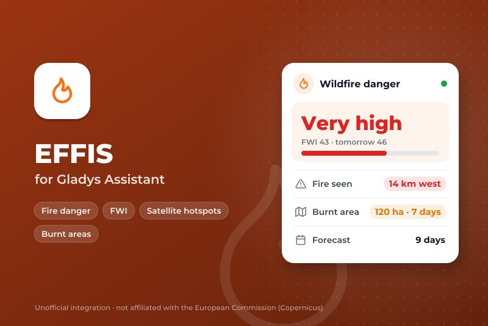
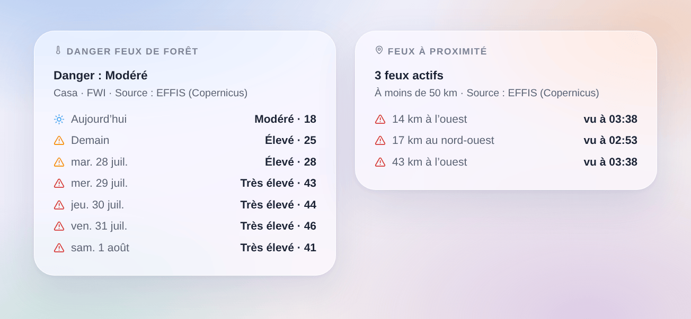
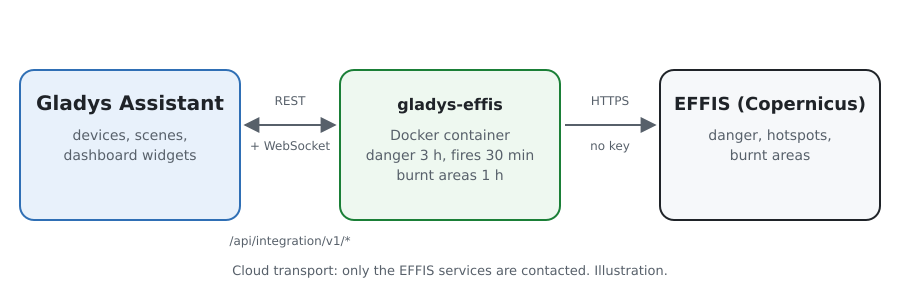
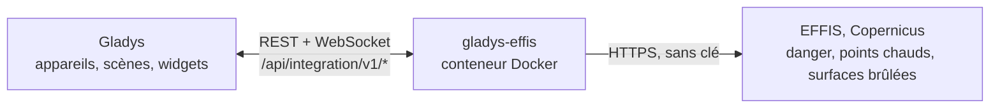
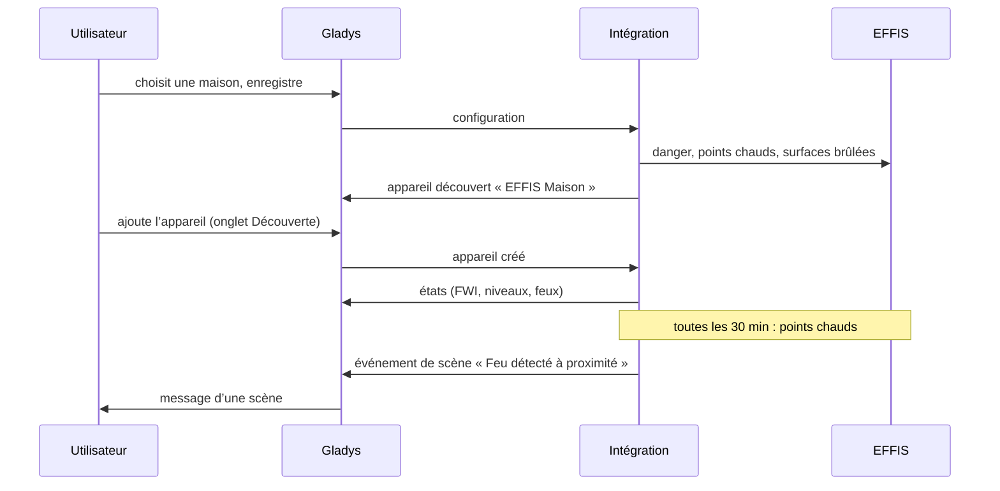

# Gladys EFFIS

[English](README.md) · **Français** · [Deutsch](README.de.md) · [Español](README.es.md)

[](LICENSE)
[](https://github.com/William-De71/gladys-effis/releases)
[](https://github.com/William-De71/gladys-effis/actions/workflows/release.yml)
[](https://gladysassistant.com)



Une intégration externe pour [Gladys Assistant](https://gladysassistant.com) qui apporte EFFIS, le système européen d’information sur les feux de forêt de Copernicus (Commission européenne), dans Gladys : la prévision du danger de feux de forêt de vos lieux, les feux vus par satellite autour d’eux et les surfaces brûlées qu’EFFIS cartographie. Données ouvertes sous licence CC BY 4.0 : aucun compte, aucune clé.

Documentation utilisateur : [English](docs/en.md) · [Français](docs/fr.md) · [Deutsch](docs/de.md) · [Español](docs/es.md).

## Fonctionnalités

- Un **appareil par lieu** (une maison de Gladys ou des coordonnées, jusqu’à trois) : indice forêt météo et niveau de danger du jour, danger du lendemain, feux vus par satellite à proximité, la situation en une phrase.
- **3 déclencheurs de scène** : niveau de danger changé (filtres : niveau, monte ou baisse), feu détecté à proximité, surface brûlée à proximité.
- **1 action de scène** : le danger d’incendie d’aujourd’hui, de demain ou d’après-demain, avec les feux à proximité.
- **2 widgets** : le danger des jours suivants, les feux à proximité.
- Un rayon de 10 à 100 km ; anglais, français, allemand et espagnol partout.

Ce n’est pas un service d’alerte officiel : un feu vu par satellite peut être un brûlage agricole ou une source de chaleur industrielle, et une absence de détection ne veut pas dire qu’il n’y a pas de feu.



## Fonctionnement







Le danger d’incendie est l’indice forêt météo canadien (FWI) de la prévision d’EFFIS (modèle ECMWF, 8 km), lu pour le lieu, une valeur par jour d’hier à 9 jours ; son niveau suit les classes des cartes d’EFFIS. Les points chauds sont les anomalies thermiques des dernières 24 heures (MODIS, VIIRS, Sentinel-3) dans une zone autour du lieu ; des points chauds à moins de 2 km les uns des autres forment un seul feu. Les surfaces brûlées sont les feux cartographiés par EFFIS (Europe, Moyen-Orient, Afrique du Nord).

### Transport

Cloud uniquement : l’intégration contacte les serveurs EFFIS de la Commission européenne (`api.effis.emergency.copernicus.eu`, `maps.effis.emergency.copernicus.eu`) et rien d’autre. Les coordonnées de vos lieux leur sont envoyées. Le catalogue affiche le badge « cloud ».

## Appareils et fonctionnalités

| Fonctionnalité                | Catégorie / type             | Valeurs                                                              |
| ----------------------------- | ---------------------------- | -------------------------------------------------------------------- |
| Indice forêt météo (FWI)      | `risk` / `integer`           | 0 à 200, FWI du jour arrondi                                         |
| Danger d’incendie aujourd’hui | `risk` / `integer`           | 0 faible, 1 modéré, 2 élevé, 3 très élevé, 4 extrême, 5 très extrême |
| Danger d’incendie demain      | `risk` / `integer`           | idem, demain                                                         |
| Feux à proximité (24 h)       | `counter-sensor` / `integer` | feux vus par satellite dans le rayon                                 |
| Situation                     | `text` / `text`              | le danger et le feu le plus proche, en une phrase                    |

## Déclencheurs, actions de scène et widgets

| Type        | Clé                    | Usage                                                                 |
| ----------- | ---------------------- | --------------------------------------------------------------------- |
| Déclencheur | `danger_level_changed` | Le niveau du jour a changé (filtres : appareil, nouveau niveau, sens) |
| Déclencheur | `fire_detected`        | Un nouveau feu vu par satellite dans le rayon                         |
| Déclencheur | `burnt_area_mapped`    | Une nouvelle surface brûlée cartographiée par EFFIS dans le rayon     |
| Action      | `get_fire_danger`      | Aujourd’hui, demain ou après-demain : FWI, niveau, feux, résumé       |
| Widget      | `danger`               | Le niveau du jour et des jours suivants (3 à 9)                       |
| Widget      | `fires`                | Feux vus en 24 h, surfaces brûlées cartographiées en 7 jours          |

Exemples :

- Quand le niveau devient très élevé ou plus → envoyer `{{triggerEvent.data.summary}}` et arroser le jardin le soir.
- Quand un feu est détecté à proximité → envoyer `{{triggerEvent.data.summary}}` à la famille.
- Chaque matin (scène planifiée) → « Obtenir le danger d’incendie » → un message quand le niveau est élevé ou plus.

## Prérequis

- Gladys Assistant **5.3.0** ou plus récent (sélecteur de maison, mots-clés du catalogue, widgets et scènes des intégrations externes). Les instances plus anciennes ne peuvent pas l’installer.
- Une maison localisée dans Gladys, ou des coordonnées ; un accès à Internet depuis Gladys.

## Installation

- **Depuis le store** : Intégrations → chercher « EFFIS » → Installer.
- **Depuis l’URL du dépôt** : Intégrations → Installer une intégration → `https://github.com/William-De71/gladys-effis`.
- **Mode développeur** : voir la documentation de Gladys sur les intégrations externes, et [Développement](#développement).

## Configuration

| Champ                   | Description                                                       |
| ----------------------- | ----------------------------------------------------------------- |
| Maison (×3)             | Une maison de Gladys : sa position est utilisée                   |
| Ou des coordonnées (×3) | « latitude, longitude », prioritaires sur la maison               |
| Rayon                   | 10, 25 (par défaut), 50 ou 100 km                                 |
| Langue                  | Noms des fonctionnalités, textes des scènes et état ; automatique |

L’action **Vérifier les lieux** affiche les coordonnées utilisées et ce qu’EFFIS indique là-bas maintenant.

## Utilisation

1. Configurez les lieux et enregistrez.
2. Dans l’onglet **Découverte**, ajoutez les appareils « EFFIS … ».
3. Ajoutez les widgets à un tableau de bord et créez des scènes avec les déclencheurs et l’action. Le détail est dans la [documentation](docs/fr.md).

## Développement

```bash
npm install
npm test                       # node --test, ne touche jamais le réseau (réponses EFFIS enregistrées)
npm run lint && npm run format:check
npx github:GladysAssistant/integration-store . --skip-image-check
scripts/build-cover.sh         # cover.jpg depuis docs/assets/cover.svg
docs/illustrations/render.sh   # docs/assets/widgets.<langue>.png
node .github/scripts/release.mjs next
```

En local, le SDK lit `GLADYS_HOST_API_URL`, `GLADYS_INTEGRATION_TOKEN` et `GLADYS_INTEGRATION_SELECTOR`, et `TZ` fixe le fuseau des jours ; `DEBUG=gladys-integration-sdk` affiche les journaux du SDK. Les règles du projet sont dans [CLAUDE.md](CLAUDE.md).

## Processus de release


Chaque fusion sur `main` lance la CI, puis calcule la version à partir des [Conventional Commits](https://www.conventionalcommits.org/fr/) depuis le dernier tag : `feat` → mineure, `fix` / `perf` → correctif, `!` ou `BREAKING CHANGE` → majeure (mineure avant 1.0.0) ; `docs`, `chore`, `ci`, `test`, `style`, `refactor`, `build` seuls ne publient rien. La section du changelog est générée, le tag poussé, l’image multi-architecture construite, puis `main` reçoit le commit de release, la GitHub Release est créée et un dernier job vérifie l’image publique, le validateur du store et le topic.

- Le titre de la pull request devient le commit squash, puis la ligne du changelog : écrivez-le en anglais, pour l’utilisateur. Ne modifiez jamais `CHANGELOG.md` à la main.
- 1.0.0 est une décision : Actions → Release → Run workflow avec `release-as: 1.0.0`. `dry-run` affiche la version et les notes sans rien publier.
- **Branche protégée** : des rulesets imposent une pull request sur `main` et verrouillent les tags `v*` ; seuls le mainteneur et les deploy keys passent. La release pousse avec la deploy key de l’environnement `release` (secret `RELEASE_DEPLOY_KEY`, `main` seulement) : un run lancé depuis une autre branche ne l’obtient jamais. `build.yml` et `github-release.yml` ne démarrent pas sur un tag : la release les appelle, ou lancez-les à la main (Actions → Run workflow, avec `version` pour l’image) pour terminer une release.

## Dépannage

Voir la [documentation](docs/fr.md#dépannage) : maison sans position, coordonnées non comprises, EFFIS occupé, feu sur la carte d’EFFIS mais pas dans Gladys.

## Contribuer

Issues et pull requests bienvenues. Lancez `npm run format:check && npm run lint && npm test` avant d’ouvrir une pull request, et ne changez jamais une clé stockée (identifiants externes, clés des déclencheurs et de l’action : voir [CLAUDE.md](CLAUDE.md)).

## Sécurité

Voir [SECURITY.md](SECURITY.md) : signalez les vulnérabilités en privé. L’intégration n’a aucun secret, n’envoie que des coordonnées à EFFIS et tourne en lecture seule, sans droits root, dans son conteneur.

## Captures à venir

De vraies captures de l’appareil dans Gladys (onglet Découverte, page de l’appareil) remplaceront les illustrations générées une fois l’intégration utilisée sur une vraie instance.

## Licence

[Apache-2.0](LICENSE). Données : EFFIS, service de gestion des urgences Copernicus, Commission européenne, sous licence CC BY 4.0 : voir [NOTICE](NOTICE). Sans lien avec la Commission européenne ; pas un service d’alerte officiel.
