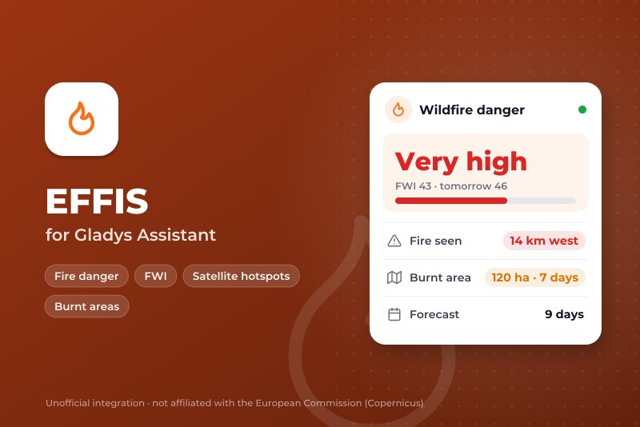
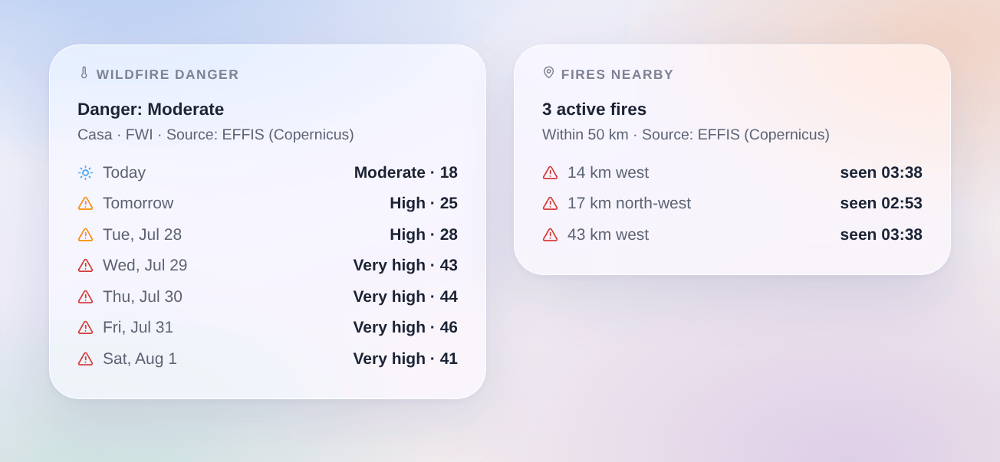
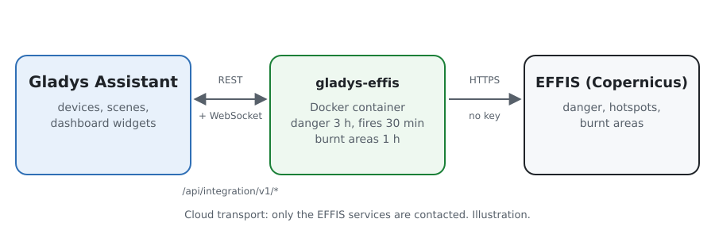
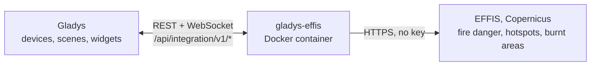
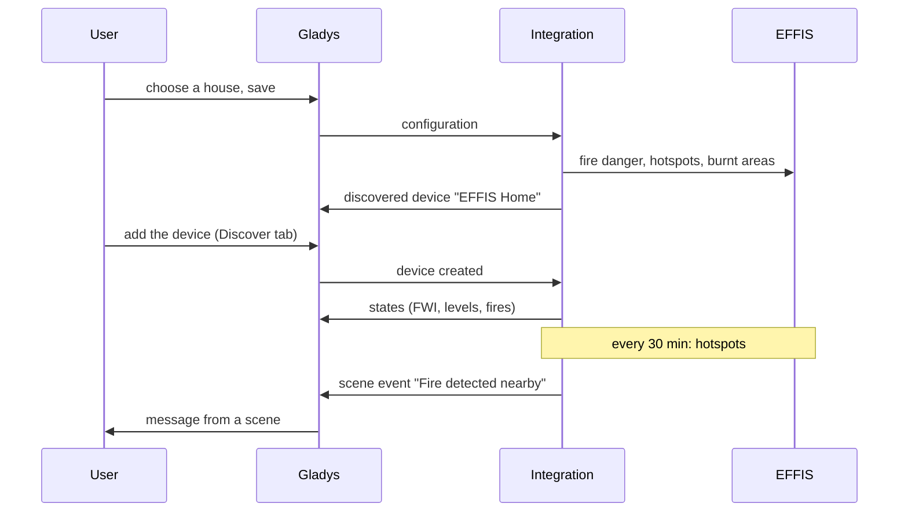

# Gladys EFFIS

**English** · [Français](README.fr.md) · [Deutsch](README.de.md) · [Español](README.es.md)

[](LICENSE)
[](https://github.com/William-De71/gladys-effis/releases)
[](https://github.com/William-De71/gladys-effis/actions/workflows/release.yml)
[](https://gladysassistant.com)



An external integration for [Gladys Assistant](https://gladysassistant.com) that brings EFFIS, the European Forest Fire Information System of Copernicus (European Commission), into Gladys: the wildfire danger forecast of your places, the fires seen by satellite around them and the burnt areas EFFIS maps. Open data under CC BY 4.0: no account, no key.

User documentation: [English](docs/en.md) · [Français](docs/fr.md) · [Deutsch](docs/de.md) · [Español](docs/es.md).

## Features

- A **device per place** (a house of Gladys or coordinates, up to three): Fire Weather Index and danger level of today, danger of tomorrow, fires seen by satellite nearby, the situation as a sentence.
- **3 scene triggers**: danger level changed (filters: level, rises or falls), fire detected nearby, burnt area mapped nearby.
- **1 scene action**: the fire danger of today, tomorrow or the day after, with the fires nearby.
- **2 dashboard widgets**: the danger of the next days, the fires nearby.
- A radius of 10 to 100 km; English, French, German and Spanish everywhere.

Not an official alert service: a fire seen by satellite can be a farm burn or an industrial heat source, and a missing detection does not mean there is no fire.



## How it works







The fire danger is the Canadian Fire Weather Index of the EFFIS forecast (ECMWF model, 8 km), read for the place, a value a day from yesterday to 9 days ahead; its level follows the classes of the EFFIS maps. Hotspots are the thermal anomalies of the last 24 hours (MODIS, VIIRS, Sentinel-3) in a box around the place; hotspots closer than 2 km are one fire. Burnt areas are the fires EFFIS mapped (Europe, Middle East, North Africa).

### Transport

Cloud only: the integration contacts the EFFIS servers of the European Commission (`api.effis.emergency.copernicus.eu`, `maps.effis.emergency.copernicus.eu`) and nothing else. The coordinates of your places are sent to them. The catalog shows the "cloud" badge.

## Devices and features

| Feature              | Category / type              | Values                                                            |
| -------------------- | ---------------------------- | ----------------------------------------------------------------- |
| Fire Weather Index   | `risk` / `integer`           | 0 to 200, FWI of today rounded                                    |
| Fire danger today    | `risk` / `integer`           | 0 low, 1 moderate, 2 high, 3 very high, 4 extreme, 5 very extreme |
| Fire danger tomorrow | `risk` / `integer`           | the same, tomorrow                                                |
| Fires nearby (24 h)  | `counter-sensor` / `integer` | fires seen by satellite within the radius                         |
| Situation            | `text` / `text`              | the danger and the nearest fire, as a sentence                    |

## Scene triggers, actions and widgets

| Kind    | Key                    | Use                                                                |
| ------- | ---------------------- | ------------------------------------------------------------------ |
| Trigger | `danger_level_changed` | The level of today changed (filters: device, new level, up / down) |
| Trigger | `fire_detected`        | A new fire seen by satellite within the radius                     |
| Trigger | `burnt_area_mapped`    | A new burnt area mapped by EFFIS within the radius                 |
| Action  | `get_fire_danger`      | Today, tomorrow or the day after: FWI, level, fires, summary       |
| Widget  | `danger`               | The level of today and of the next days (3 to 9)                   |
| Widget  | `fires`                | Fires seen in 24 h, burnt areas mapped in 7 days                   |

Examples:

- When the level becomes very high or more → send `{{triggerEvent.data.summary}}` and water the garden in the evening.
- When a fire is detected nearby → send `{{triggerEvent.data.summary}}` to the family.
- Every morning (scheduled scene) → "Get the fire danger" → a message when the level is high or more.

## Requirements

- Gladys Assistant **5.3.0** or later (house selector, catalog keywords, widgets and scenes of external integrations). Older instances cannot install it.
- A house located in Gladys, or coordinates; Internet access from Gladys.

## Installation

- **From the store**: Integrations → search "EFFIS" → Install.
- **From the repository URL**: Integrations → Install an integration → `https://github.com/William-De71/gladys-effis`.
- **Developer mode**: see the Gladys documentation on external integrations, and [Development](#development).

## Configuration

| Field               | Description                                                 |
| ------------------- | ----------------------------------------------------------- |
| House (×3)          | A house of Gladys: its location is used                     |
| Or coordinates (×3) | "latitude, longitude", win over the house                   |
| Radius              | 10, 25 (default), 50 or 100 km                              |
| Language            | Feature names, scene texts and status; automatic by default |

The action **Check the places** shows the coordinates used and what EFFIS says there now.

## Usage

1. Configure the places and save.
2. In the **Discover** tab, add the "EFFIS …" devices.
3. Add the widgets to a dashboard and create scenes with the triggers and the action. The details are in the [documentation](docs/en.md).

## Development

```bash
npm install
npm test                       # node --test, never touches the network (recorded EFFIS answers)
npm run lint && npm run format:check
npx github:GladysAssistant/integration-store . --skip-image-check
scripts/build-cover.sh         # cover.jpg from docs/assets/cover.svg
docs/illustrations/render.sh   # docs/assets/widgets.<lang>.png
node .github/scripts/release.mjs next
```

Locally, the SDK reads `GLADYS_HOST_API_URL`, `GLADYS_INTEGRATION_TOKEN` and `GLADYS_INTEGRATION_SELECTOR`, and `TZ` sets the timezone of the days; `DEBUG=gladys-integration-sdk` prints the SDK logs. The rules of the project are in [CLAUDE.md](CLAUDE.md).

## Release process


Every merge on `main` runs the CI, then computes the version from the [Conventional Commits](https://www.conventionalcommits.org/) since the last tag: `feat` → minor, `fix` / `perf` → patch, `!` or `BREAKING CHANGE` → major (a minor before 1.0.0); `docs`, `chore`, `ci`, `test`, `style`, `refactor`, `build` alone publish nothing. The changelog section is generated, the tag pushed, the multi-arch image built, then `main` receives the release commit, the GitHub Release is created and a last job checks the public image, the store validator and the topic.

- The pull request title becomes the squash commit, then the changelog line: write it in English, for the user. Never edit `CHANGELOG.md` by hand.
- 1.0.0 is a decision: Actions → Release → Run workflow with `release-as: 1.0.0`. `dry-run` shows the version and the notes without publishing anything.
- **Protected branch**: rulesets require a pull request on `main` and lock the `v*` tags; only the maintainer and deploy keys get through. The release pushes with the deploy key of the `release` environment (secret `RELEASE_DEPLOY_KEY`, `main` only): a run from another branch never gets it. `build.yml` and `github-release.yml` do not start on a tag: the release calls them, or run them by hand (Actions → Run workflow, with `version` for the image) to finish a release.

## Troubleshooting

See the [documentation](docs/en.md#troubleshooting): a house without a position, coordinates not understood, EFFIS busy, a fire on the EFFIS map but not in Gladys.

## Contributing

Issues and pull requests welcome. Run `npm run format:check && npm run lint && npm test` before opening a pull request, and never change a stored key (external ids, trigger and action keys: see [CLAUDE.md](CLAUDE.md)).

## Security

See [SECURITY.md](SECURITY.md): report vulnerabilities privately. The integration has no secret, sends only coordinates to EFFIS, and runs read-only, without root rights, in its container.

## Screenshots to come

Real screenshots of the device in Gladys (Discover tab, device page) will replace the generated illustrations once the integration runs on a real instance.

## License

[Apache-2.0](LICENSE). Data: EFFIS, Copernicus Emergency Management Service, European Commission, under CC BY 4.0: see [NOTICE](NOTICE). Not affiliated with the European Commission; not an official alert service.
