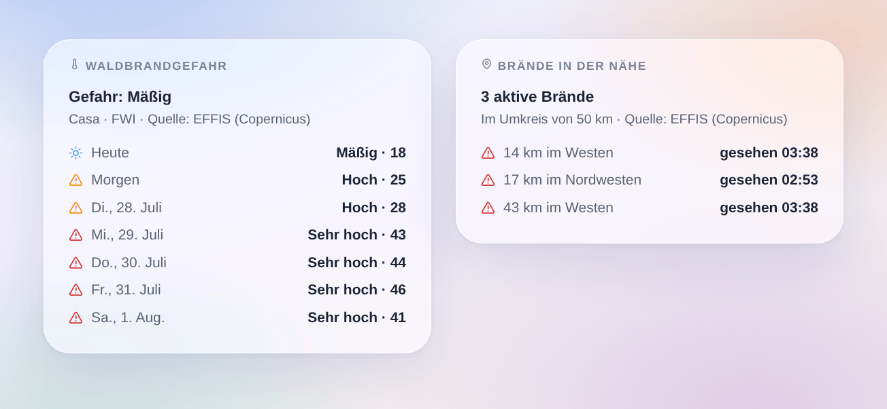

# EFFIS

## Überblick

EFFIS, das Europäische Waldbrandinformationssystem des Copernicus-Katastrophen- und Krisenmanagementdienstes (Europäische Kommission), in Gladys. Für jeden Ihrer Orte (bis zu drei):

- die **Waldbrandgefahr** heute und in den nächsten 9 Tagen: der Feuerwetterindex (FWI) der EFFIS-Vorhersage und seine Stufe, von gering bis sehr extrem;
- die **per Satellit erkannten Brände** der letzten 24 Stunden in einem Umkreis Ihrer Wahl (Hotspots von MODIS, VIIRS und Sentinel-3);
- die von EFFIS in den letzten 7 Tagen **kartierten Brandflächen** in diesem Umkreis.

Kein Konto, kein Schlüssel: Die Daten von EFFIS sind offene Daten unter der Lizenz CC BY 4.0. Dies ist kein offizieller Warndienst: Ein per Satellit erkannter Brand kann ein Agrarfeuer oder eine industrielle Wärmequelle sein, und keine Erkennung heißt nicht, dass es nicht brennt. Befolgen Sie immer die Anweisungen der Behörden.

## Voraussetzungen

- Gladys Assistant 5.3.0 oder neuer.
- Ein in Gladys verortetes Haus (Einstellungen > Häuser) oder die Koordinaten des zu überwachenden Ortes.
- Internetzugang von Gladys aus: Die Daten kommen von den EFFIS-Servern.

## Konfiguration

1. Installieren Sie die Integration unter **Integrationen** (EFFIS).
2. Wählen Sie für jeden Ort ein **Haus** oder geben Sie **Koordinaten** ein („43.2965, 5.3698“; sie haben Vorrang vor dem Haus).
3. Wählen Sie den **Umkreis** um jeden Ort und speichern Sie. **Orte prüfen** zeigt die verwendeten Koordinaten und was EFFIS dort gerade meldet.
4. Fügen Sie im Reiter **Entdecken** die gewünschten Geräte hinzu.

| Feld             | Standard    | Wirkung                                                                             |
| ---------------- | ----------- | ----------------------------------------------------------------------------------- |
| Haus             |             | Ein Gladys-Haus: seine Position wird verwendet.                                     |
| Oder Koordinaten |             | Breite, Länge: Zweitwohnsitz, Wald in der Nähe. Haben Vorrang vor dem Haus.         |
| Umkreis          | 25 km       | Brände und Brandflächen werden in dieser Entfernung überwacht (10, 25, 50, 100 km). |
| Sprache          | Automatisch | Namen der Funktionen, Szenentexte und Status.                                       |

## Verwendung

### Geräte

Ein Gerät pro Ort, „EFFIS <Ort>“, nur lesend:

- **Feuerwetterindex (FWI)**: der heutige FWI, gerundet.
- **Waldbrandgefahr heute** und **Waldbrandgefahr morgen**: 0 gering (FWI unter 11,2), 1 mäßig, 2 hoch (ab 21,3), 3 sehr hoch (ab 38), 4 extrem (ab 50), 5 sehr extrem (ab 70), die Klassen der EFFIS-Karten.
- **Brände in der Nähe (24 h)**: die per Satellit erkannten Brände im Umkreis. Hotspots, die weniger als 2 km auseinanderliegen, zählen als ein Brand.
- **Lage**: die Gefahr und der nächste Brand, als Satz.

Die Vorhersage wird alle 3 Stunden und an jedem neuen Tag gelesen, die Hotspots alle 30 Minuten, die Brandflächen stündlich.

### Szenen

Auslöser:

- **Gefahrenstufe geändert**: wenn sich die heutige Stufe ändert (neue Vorhersage oder neuer Tag). Filter: Gerät, neue Stufe, steigt oder sinkt.
- **Brand in der Nähe erkannt**: ein per Satellit erkannter Brand im Umkreis, der noch nicht gesehen wurde. Variablen: Entfernung, Richtung, Uhrzeit, Hotspots, Position.
- **Brandfläche in der Nähe**: eine von EFFIS kartierte Brandfläche im Umkreis. Variablen: Fläche in Hektar, Gemeinde, Provinz, Land, Branddatum, Entfernung.

Die erste Lesung nach einem Start dient als Referenz: Kein Auslöser wiederholt einen bereits vorhandenen Brand oder eine Stufe.

Aktion **Waldbrandgefahr abrufen** (heute, morgen oder übermorgen): FWI, Stufe, Brände in der Nähe, nächster Brand und ein Zusammenfassungssatz.

Beispiele:

- „Gefahrenstufe geändert“, Stufe sehr hoch, extrem oder sehr extrem → „{{triggerEvent.data.summary}}“ senden und abends die Gartenbewässerung starten.
- „Brand in der Nähe erkannt“ → „{{triggerEvent.data.summary}}“ an die Familie senden.
- Jeden Morgen um 7 Uhr (geplante Szene) → „Waldbrandgefahr abrufen“ (heute) → die Zusammenfassung senden, wenn die Stufe hoch oder höher ist.

### Widgets

- **Waldbrandgefahr**: die Stufe heute und an den nächsten Tagen (3 bis 9, Einstellung „Tage“), mit dem FWI.
- **Brände in der Nähe**: die per Satellit erkannten Brände der letzten 24 Stunden (Entfernung, Richtung, Uhrzeit) und die in 7 Tagen kartierten Brandflächen (Gemeinde, Fläche, Entfernung, Datum).

Beide nennen die Quelle, wie es die Lizenz von EFFIS verlangt.

## Fehlerbehebung

- **„Das Haus hat keine Position“**: Legen Sie die Position des Hauses unter Einstellungen > Häuser fest oder geben Sie Koordinaten ein.
- **„Koordinaten nicht verstanden“**: Geben Sie Breite, dann Länge in Dezimalgrad ein: „43.2965, 5.3698“.
- **„EFFIS antwortet derzeit nicht“**: Die EFFIS-Server sind ausgelastet oder in Wartung; die Integration versucht es selbst erneut und behält die letzten Daten.
- **Ein Brand auf der EFFIS-Karte, aber nicht in Gladys**: Die Satelliten überfliegen den Ort einige Male am Tag, und Wolken oder Rauch können einen Brand verdecken; EFFIS kartiert eine Brandfläche anhand der Satellitenbilder, meist einen Tag oder später nach dem Brand.
- Protokolle: der Reiter **Protokolle** der Integration. Im Entwicklermodus fügt `DEBUG=gladys-integration-sdk` die SDK-Protokolle hinzu.
