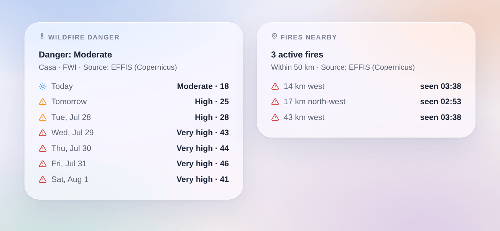

# EFFIS

## Overview

EFFIS, the European Forest Fire Information System of the Copernicus Emergency Management Service (European Commission), in Gladys. For each of your places (up to three):

- the **fire danger** of today and of the next 9 days: the Fire Weather Index (FWI) of the EFFIS forecast and its level, from low to very extreme;
- the **fires seen by satellite** in the last 24 hours within a radius you choose (MODIS, VIIRS and Sentinel-3 hot spots);
- the **burnt areas** EFFIS mapped in the last 7 days within that radius.

No account, no key: EFFIS data is open data under the CC BY 4.0 licence. This is not an official alert service: a fire seen by satellite can be a farm burn or an industrial heat source, and a missing detection does not mean there is no fire. Always follow the instructions of the authorities.

## Requirements

- Gladys Assistant 5.3.0 or later.
- A house located in Gladys (Settings > Houses), or the coordinates of the place to watch.
- Internet access from Gladys: the data comes from the EFFIS servers.

## Configuration

1. Install the integration from **Integrations** (EFFIS).
2. For each place, choose a **House**, or type **coordinates** ("43.2965, 5.3698"; they win over the house).
3. Choose the **radius** around each place, then save. **Check the places** shows the coordinates used and what EFFIS says there now.
4. In the **Discover** tab, add the devices you want.

| Field          | Default   | What it does                                                                   |
| -------------- | --------- | ------------------------------------------------------------------------------ |
| House          |           | A house of Gladys: its location is used.                                       |
| Or coordinates |           | Latitude, longitude: a second home, a forest nearby. Win over the house.       |
| Radius         | 25 km     | Fires and burnt areas are watched within this distance (10, 25, 50 or 100 km). |
| Language       | Automatic | Feature names, scene texts and status.                                         |

## Usage

### Devices

One device per place, "EFFIS <place>", read-only:

- **Fire Weather Index**: the FWI of today, rounded.
- **Fire danger today** and **Fire danger tomorrow**: 0 low (FWI under 11.2), 1 moderate, 2 high (from 21.3), 3 very high (from 38), 4 extreme (from 50), 5 very extreme (from 70), the classes of the EFFIS maps.
- **Fires nearby (24 h)**: the fires seen by satellite within the radius. Hot spots closer than 2 km are counted as one fire.
- **Situation**: the danger and the nearest fire, as a sentence.

The forecast is read every 3 hours and at each new day, the hot spots every 30 minutes, the burnt areas every hour.

### Scenes

Triggers:

- **Fire danger level changed**: when the level of today changes (a new forecast, or a new day). Filters: device, new level, rises or falls.
- **Fire detected nearby**: a fire seen by satellite within the radius, not seen before. Variables: distance, direction, time, hot spots, position.
- **Burnt area mapped nearby**: a burnt area mapped by EFFIS within the radius. Variables: area in hectares, municipality, province, country, fire date, distance.

The first reading after a start is a reference: no trigger replays a fire or a level already there.

Action **Get the fire danger** (today, tomorrow or the day after): FWI, level, fires nearby, nearest fire, and a summary sentence.

Examples:

- "Fire danger level changed", level very high, extreme or very extreme → send "{{triggerEvent.data.summary}}" and turn the garden watering on in the evening.
- "Fire detected nearby" → send "{{triggerEvent.data.summary}}" to the family.
- Every morning at 7:00 (scheduled scene) → "Get the fire danger" (today) → send its summary when the level is high or more.

### Widgets

- **Wildfire danger**: the level of today and of the next days (3 to 9, setting "Days"), with the FWI.
- **Fires nearby**: the fires seen by satellite in 24 hours (distance, direction, time) and the burnt areas mapped in 7 days (municipality, area, distance, date).

Both credit the source, as the licence of EFFIS asks.

## Troubleshooting

- **"The house has no position"**: locate the house in Settings > Houses, or type coordinates.
- **"Coordinates not understood"**: type the latitude, then the longitude, in decimal degrees: "43.2965, 5.3698".
- **"EFFIS does not answer for now"**: the EFFIS servers are busy or in maintenance; the integration tries again by itself and keeps the last data.
- **A fire on the EFFIS map but not in Gladys**: the satellites pass a few times a day, and clouds or smoke can hide a fire; EFFIS maps a burnt area from the satellite images, usually a day or more after the fire.
- Logs: the **Logs** tab of the integration. In developer mode, `DEBUG=gladys-integration-sdk` adds the SDK logs.
